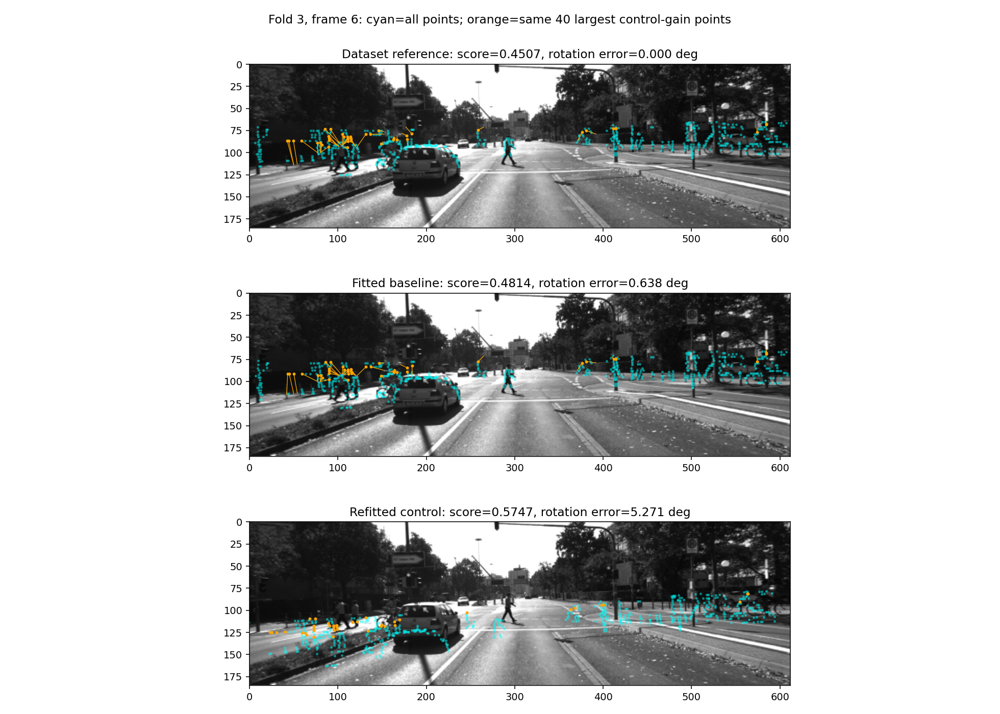
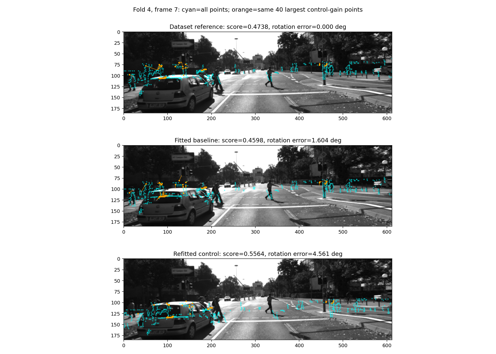

# Camera–LiDAR: what the wrong pitch-control poses match

**Finding:** the nearest-ridge score can prefer a visibly displaced projection
over the dataset reference. Small pitch error alone also hid large roll/yaw
errors in the fitted baseline. This diagnostic explains the previous negative
result; it is not another optimizer run or a calibration improvement.

## Fixed-pose replay

Use the saved nearest-ridge pitch-axis folds for 2011_09_28_0002, pitch +3.
Verify the snapshot and source hashes, recreate the existing prepared frames,
and score the saved baseline and both saved nuisance-refitted controls. Undo
the known injected rotation for a fourth pose, the dataset reference. No pose
is fitted or selected for adoption using these scores.

All six saved held-out control drops reproduce within absolute 1e-9. Every
per-point contribution sums to the existing objective within absolute 1e-12,
including zero contributions outside the image and the unchanged denominator.
The existing preparation retains 11 of the 38 captured frames; this diagnostic
uses all 11, without changing frame selection. A synthetic test checks bilinear
attribution and preservation of out-of-image point weight.

[All frame scores and attribution](../assets/pitch_match_diagnostics_20261028/report.json)
are retained with a schema and [hash manifest](../assets/pitch_match_diagnostics_20261028/manifest.json).
The generator is `tools/kitti_camera_lidar_match_diagnostics.py`; plotting requires
Matplotlib in addition to the research environment's existing dependencies.

## Whole-pose errors change the interpretation

The earlier nearest-ridge report correctly described active-axis pitch errors
within 0.052 deg, but this must not be read as an accurate full rotation.
The reference-relative rotation-vector norm of the fitted baseline ranges from
0.638 to 4.717 deg because roll/yaw can move during nuisance fitting.

| Fold | Baseline full rotation error (deg) | Reference score | Baseline score | Minus-pitch control score | Plus-pitch control score |
| --- | ---: | ---: | ---: | ---: | ---: |
| 0 | 3.858 | 0.4435 | 0.3329 | 0.3257 | 0.3255 |
| 1 | 2.761 | 0.3855 | 0.4563 | 0.4462 | 0.4291 |
| 2 | 0.642 | 0.4833 | 0.5035 | 0.5534 | 0.5472 |
| 3 | 0.638 | 0.4507 | 0.4814 | 0.5747 | 0.5532 |
| 4 | 1.604 | 0.4214 | 0.4192 | 0.3928 | 0.5152 |
| 5 | 4.717 | 0.3743 | 0.4135 | 0.3631 | 0.4384 |

At least one saved control beats the reference in five of six pooled folds and
10 of 11 individual frames. It beats the fitted baseline in four pooled folds.
These are descriptive comparisons against two existing controls, not independent
success trials or new held-out claims. The repeated failures mean this example
is not explained solely by one bad frame or one training initialization.

## Visible match substitution

Each figure uses the frame/control pair with the largest control-minus-baseline
score in its fold, including the least-negative pair when neither wins. All six
examples are retained; this selection is explicitly post hoc. Cyan shows all
prepared points; orange identifies the same 40 largest positive-gain-ranked points
across the three poses. Lines connect those projections to a nearest image ridge
using rounded image pixels for illustration; exact scores use bilinear sampling.

In fold 3, a control with 5.271 deg full rotation disagreement scores 0.5747,
versus 0.4507 for the reference. The point pattern shifts down toward sidewalk
and road-side contours rather than preserving the reference boundary locations.
The displacement is visible across the image, not only on the car.

In the fold 4 example, some points near the car roof in the reference projection
move onto window/body contours under the control. The wrong pose has 4.561 deg
full rotation disagreement yet scores 0.5564 versus 0.4738 for the reference in
that frame. These object descriptions are visual interpretations, not annotated
semantic ground truth or proof that a specific surface caused every gain.

Other examples: [fold 0](../assets/pitch_match_diagnostics_20261028/fold-0.png),
[fold 1](../assets/pitch_match_diagnostics_20261028/fold-1.png),
[fold 2](../assets/pitch_match_diagnostics_20261028/fold-2.png), and
[fold 5](../assets/pitch_match_diagnostics_20261028/fold-5.png).

## Development consequence

Do not pursue another distance cutoff or score threshold adjustment. The next
hypothesis should preserve boundary identity or structure across matches, rather
than rewarding arbitrary nearby image ridges independently. Report full rotation
error alongside active-axis error in future ablations. Repeated wrong-pose score
advantages across nearby frames mean temporal score consistency alone is not a
sufficient fix; actual correspondence identity must be checked. This diagnostic
does not track 3D identities across frames and cannot establish that such a method
will work. No native defaults, prior verdicts or audit thresholds change.
