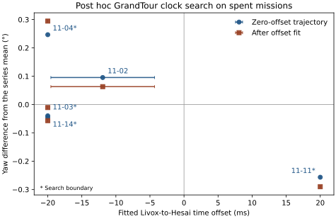

# GrandTour LiDAR–LiDAR rotation scatter

**Post hoc Task A, on the five spent GrandTour missions.** Calibrex source
`f8f44d66520195874d507d4c4fa4d736f6e74b68`, branch
`claude/nifty-hypatia-6nsmas`. GrandTour revision
`af6b6dd6f91696f8ec8c98134e195514834911b2` (MIT). The mission dates in this
note refer to 2024-11-02-17-43-10, 2024-11-03-07-52-45,
2024-11-04-13-07-13, 2024-11-11-12-42-47 and 2024-11-14-13-45-37.
Inputs were checked against the SHA-256s in the pinned dataset tree. The
published GrandTour v1 verdict is refuted (2/6).
[GrandTour v1 audit](../benchmarks/grand_tour_lidar_lidar.md)

## Post hoc findings

| Hypothesis | Result |
| --- | --- |
| Hesai–Livox clock offset | Fitted offsets span -20.00 to +20.00 ms (4/5 search-edge minima). Excluding 11-04, the per-point yaw span is 0.352° at zero offset and 0.353° after the refit. |
| Scene geometry | Across 99 training blocks, the largest single-block deletion shifts yaw by 0.019°. The smallest median normal eigenvalue correlates with yaw at r = +0.89 across the four missions excluding 11-04. |
| Hesai intrinsics | Selecting rings 22–31 shifts yaw by +0.080° to +0.320° across five missions. Range-band shifts reach 0.137° in magnitude. These are sensitivities to the reference point selection. |
| Deskew and point placement | In the 11-02 factorial, per-point placement changes yaw by +0.113°. Switching off reference odometry deskew changes yaw by less than 0.001°. |
| Physical mount movement | On 11-04, relative yaw is +0.391° in LiDAR and +0.301°/+0.521° in the two gyro-only comparisons. The two gyro references disagree on the four-day residual pattern. |

## Post hoc baseline

The five committed window-zero artifacts are the baseline. Taking the rotation
of each mission relative to the SO(3) mean of the remaining missions, expressed
in the Hesai frame, gives these maximum absolute deviations.
[Window comparison](../assets/grand_tour_lidar_lidar/post_hoc/window_comparison.txt)

| Missions | About Hesai x | About Hesai y | About Hesai z | Geodesic |
| --- | ---: | ---: | ---: | ---: |
| All five | 0.1565° | 0.0246° | 0.3911° | 0.4218° |
| Four excluding 11-04 | 0.0450° | 0.0204° | 0.1046° | 0.1114° |

These are left perturbation axes in the reference frame. Euler roll and pitch
use different axes near this mounting orientation. For the four-day subset,
Euler peak-to-peak roll, pitch and yaw are 0.029°, 0.061° and 0.131°.
The 11-04 LiDAR yaw difference is +0.391° relative to the mean of the other
four. Existing odometry-free same-time evidence places the difference at
about +0.35°.

## Post hoc clock offset search

Read the pinned Zarr scan arrays directly into the repository's map evaluator.
This avoids the intermediate ROS bag and retains the converter's finite-point
mask and absolute time conventions (seconds for Hesai, nanoseconds for Livox).
Use the train-only profile implemented by `estimate_time_offset`, equivalent
to `--target-motion reference_trajectory --time-offset-search 0.02 0.002`.
The sign convention is `t_Hesai = t_Livox + offset`. The diagnostic uses
K=1, map half window zero, one target scan every 30 scans and at most 15 solver
iterations. The reference trajectory itself uses all available Hesai sweeps
and the standard odometry settings. The reference map spans the target's point
times even at half window zero. The static transforms seed the fits.

| Mission | Offset (ms) | Jackknife std (ms) | Grid minimum | Rigid yaw | Per-point yaw at zero offset | Per-point yaw with fitted offset |
| --- | ---: | ---: | --- | ---: | ---: | ---: |
| 11-02 | -11.94 | 7.61 | interior | -89.8716° | -89.7585° | -89.8022° |
| 11-03 | -20.00 | 1.36 | edge | -89.9557° | -89.8936° | -89.9224° |
| 11-04 | -20.00 | 2.81 | edge | -89.5502° | -89.6073° | -89.5707° |
| 11-11 | +20.00 | 30.96 | edge | -90.0193° | -90.1107° | -90.1555° |
| 11-14 | -20.00 | 0.00 | edge | -89.8898° | -89.8994° | -89.8761° |

In the plot, each yaw series is centered on its own five-mission mean.
Horizontal bars show one jackknife std for interior minima. An asterisk
marks a constrained boundary minimum.

The minima span -20.00 to +20.00 ms. 4 of 5 hit an edge (11-03, 11-04, 11-11, 11-14). The correlation of the profile offset with zero-offset yaw is -0.73 across all five and -0.79 across the four excluding 11-04. In the latter four, the yaw span is 0.148° for rigid scans, 0.352° after per-point placement at zero offset and 0.353° after the profile refit. The edge-constrained offsets enter those descriptive comparisons as fitted
grid limits. The zero jackknife spread on 11-14 reflects repeated selection
of the same grid boundary. This search provides no empirical reduction of
the four-day yaw span and leaves offsets beyond the grid unresolved.

## Post hoc scene geometry

For every 10 s training block of the rigid nearest-scan fit, collect the
normals of accepted point-to-plane correspondences and express them in the
reference sensor's scan frame. Treat each unit normal as an unoriented
axis, with equal weight for its two signs. Its covariance is therefore
`N.T @ N / len(N)`. Save the three sorted eigenvalues and refit the
extrinsic with just that block removed. Compare the smallest eigenvalue
against the absolute yaw shift from the full training fit. Compare the
per-mission median eigenvalues against the signed yaw differences between
missions as a separate check.

| Mission | Train blocks | Median eigenvalues | Max leave-one-block-out yaw shift | Pearson r, smallest eigenvalue vs. absolute shift |
| --- | ---: | --- | ---: | ---: |
| 11-02 | 15 | 0.210, 0.359, 0.457 | 0.018° | +0.26 |
| 11-03 | 13 | 0.086, 0.269, 0.640 | 0.016° | +0.31 |
| 11-04 | 22 | 0.179, 0.225, 0.592 | 0.007° | +0.18 |
| 11-11 | 28 | 0.045, 0.094, 0.858 | 0.017° | -0.27 |
| 11-14 | 21 | 0.116, 0.170, 0.719 | 0.019° | -0.49 |

Within missions the smallest eigenvalue versus absolute yaw shift has Pearson r from -0.49 to +0.31. Across the five missions, the correlations of the three median eigenvalues with yaw are +0.66, +0.23, -0.46. With 11-04 excluded, they are +0.89, +0.69, -0.78 (four points). Individual block deletions shift yaw by at most 0.019°. The four-day
association makes scene composition a plausible contributor, with four
mission-level observations and mixed signs at the block level.

The eigenvalues describe the directional coverage of normals. Rotation
observability also depends on their lever arms. Deleting one block measures
sensitivity within a mission, where a common bias can affect every block.
The individual eigenvalues, leave-one-out fits, clock/ring refits, IMU fits
and archive hashes are available in the accompanying evidence.
[Post hoc evidence JSON](../assets/grand_tour_lidar_lidar/post_hoc/rotation_scatter_evidence.json)

## Post hoc ring and range restrictions

Register a single Livox scan to the nearest Hesai scan.
Filter the raw Hesai reference by its recorded ring IDs (0–10, 11–21,
22–31) or Euclidean range ([1, 8), [8, 16), [16, 40] m) before 0.2 m
voxelization. Keep target clouds fixed and compare only timestamps with all
subsets present. Every 30th target scan is considered, using the 0.06 s
pairing tolerance and the standard 10 s train/holdout split. Initialize each
restricted fit at the all-cloud fit. The table gives restricted-fit yaw minus
the all-cloud yaw.

| Mission | Shared train scans | Rings 0–10 | Rings 11–21 | Rings 22–31 | 1–8 m | 8–16 m | 16–40 m |
| --- | ---: | ---: | ---: | ---: | ---: | ---: | ---: |
| 11-02 | 28 | −0.096° | +0.015° | +0.206° | +0.067° | −0.027° | −0.137° |
| 11-03 | 43 | +0.032° | +0.012° | +0.320° | +0.076° | −0.021° | +0.041° |
| 11-04 | 76 | −0.017° | −0.013° | +0.121° | +0.074° | −0.008° | −0.031° |
| 11-11 | 93 | −0.049° | −0.034° | +0.086° | +0.061° | −0.001° | −0.007° |
| 11-14 | 71 | −0.043° | +0.008° | +0.080° | +0.090° | +0.005° | −0.018° |

The ring ordering across the dates is broadly similar, with the highest IDs
producing the largest yaw on all five. Restricting the reference changes both
the sensor channels and available surfaces. These fits establish sensitivity
to the choice of points. A channel-specific correction would require a
control that holds the surfaces fixed. Far-range yaw changes sign across
scenes.

## Post hoc independent mount check

Fit a rotation directly between gyroscope streams, using Livox's built-in IMU
as the input and CPT7 and STIM320 as independent reference streams. Interpolate
onto a common 100 Hz grid, filter each stream with a zero-phase fourth-order
Butterworth low-pass and fit at 20 Hz. The robust least-squares fit jointly
estimates the rotation, three constant biases, three diagonal scale terms and
one clock lag (soft-L1 loss, scale 0.01 rad/s). Use the released frame axes
to express the day-to-day left rotation differences in the Hesai basis. The
fixed Livox LiDAR-to-IMU rotation cancels from those differences. The table
uses the 1 Hz cutoff, with 2 and 4 Hz used to check sensitivity.

| Mission | Hesai z, LiDAR | Hesai z, Livox–CPT7 | Hesai z, Livox–STIM320 |
| --- | ---: | ---: | ---: |
| 11-02 | +0.052° | +0.045° | −0.015° |
| 11-03 | −0.018° | −0.135° | +0.065° |
| 11-04 | +0.391° | +0.301° | +0.521° |
| 11-11 | −0.078° | −0.074° | +0.082° |
| 11-14 | +0.045° | +0.165° | −0.133° |

On 11-04, the sign agrees for both IMU pairs at all three cutoffs. The effect
ranges from +0.301° to +0.537° for CPT7 and from +0.521° to +0.723° for STIM320.
This supports a physical orientation change of the Livox assembly relative to
the payload. With 11-04 excluded, the 1 Hz yaw correlations with LiDAR are
+0.74 and −0.80 respectively (four missions). The correlations are sensitive
to cutoff, leaving the physical cause of the smaller scatter unresolved. In the reference-only CPT7→STIM320
control, 11-04 had +0.031° native-frame yaw at 1 Hz, inside the range of the
other dates (−0.011° to +0.097°).

## Post hoc deskew factorial

Use 11-02, zero clock offset, one target scan per sample and map half window
zero. Run both target placement modes with constant-velocity Hesai odometry
deskew and with `deskew: none`. All four use the same 30-scan sampling stride
and 10 s block policy.

| Target mode | Reference odometry deskew | Euler roll | Euler pitch | Euler yaw |
| --- | --- | ---: | ---: | ---: |
| Rigid nearest | Constant velocity | −179.9034° | −0.0271° | −89.87164° |
| Rigid nearest | None | −179.9034° | −0.0271° | −89.87164° |
| Per-point trajectory, K=1 | Constant velocity | −179.9116° | −0.0435° | −89.75855° |
| Per-point trajectory, K=1 | None | −179.9026° | −0.0311° | −89.75856° |

Both per-point runs shift yaw by +0.113° relative to rigid. Turning off the
reference odometry deskew changes yaw by less than 0.001° in either mode.
The window-zero rigid fit aligns two single raw sweeps and is invariant to
reference odometry, up to numerical precision. The trajectory fit changes both
target point placement and the reference scans spanned by the sweep, so the
0.113° contrast measures their combined effect. The setting controls deskew
inside the reference odometry. The stored reference map scans still contain
raw points.

## Post hoc conclusion and rotation uncertainty

The independent gyro checks support a change of the Livox assembly relative
to the payload on 11-04. The other four missions exhibit residual yaw scatter
of 0.105° in the window-zero leave-one-mission-out comparison. Their
within-run reported yaw standard deviations range from 0.012° to 0.044°.
The point selection and target motion contrasts are large enough to contribute at this
scale. The remaining between-mission bias does not have a uniquely identified
cause, so the production estimator stays as it is.

For the five spent missions, a conservative empirical floor that covers all
observed deviations is **[0.16°, 0.03°, 0.40°]** about the Hesai x, y and z
axes respectively (or a **0.43°** geodesic bound). This bound includes the
different 11-04 mount state. For the four-day subset after accounting for that
state, the corresponding floor is **[0.05°, 0.03°, 0.11°]** (or a **0.12°**
geodesic bound). Each value rounds up the observed leave-one-mission-out
maximum to the next 0.01°. Use the componentwise maximum of the within-run
reported standard deviation and the relevant empirical floor if expressing
the observed between-mission uncertainty per axis. These floors describe
coverage on spent data only. Independent confirmation that the mount state
is shared would be needed to apply the smaller floor.
