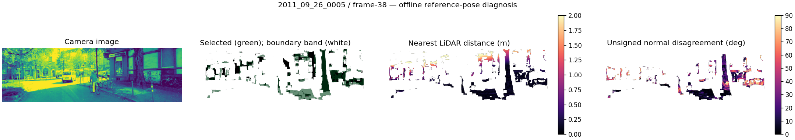
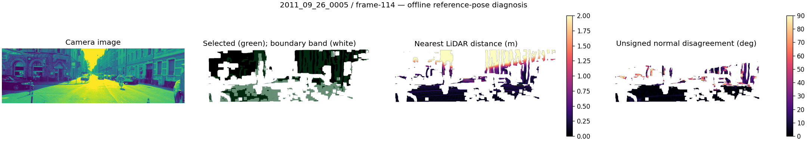
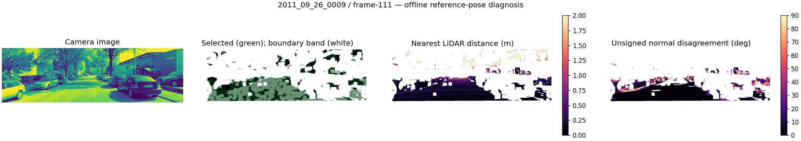

# Surface disagreement persists inside selected smooth regions

Frozen `9a8327fd`, evaluated2026-10-30. See
[protocol](surface_error_maps_protocol.md),
[plan](../assets/surface_error_maps_20261030/plan.json),
[18-frame report](../assets/surface_error_maps_20261030/evaluation.json),
[schema](../assets/surface_error_maps_20261030/evaluation.schema.json) and
[all18 plotted-map hashes](../assets/surface_error_maps_20261030/plots.sha256.json).

Further boundary exclusion is not supported as a sufficient remedy. In **18/18
frames**, normal disagreement rate is higher in the defined interior region than
in the measurement-derived boundary band. Across-frame median normal failure is
7.27% near boundaries versus17.83% in interiors. Distance failure median is7.72%
versus13.69%, with higher interior distance failure in14/18 frames.

These are rates within explicit populations, not total error shares or independent
pixel-level inference. Boundary is defined by >1px surrogate-disparity jumps and
missing depth, dilated10 pixels. It is not semantic object identity or motion.
Selection has already rejected many difficult boundary pixels, so the comparison
is conditional on the retained population and does not mean boundaries are safe.

| Previously failed frame | Normal failure near boundary | Normal failure interior | Distance failure interior |
| --- | ---: | ---: | ---: |
| 0005/frame38 | 47.1% | 68.8% | 17.3% |
| 0005/frame114 | 11.1% | 42.5% | 50.3% |
| 0009/frame111 | 17.9% | 35.5% | 13.2% |

Normal failure means >15deg unsigned angle among pairs within1m with a valid
LiDAR normal. Distance failure means >1m among selected pixels; the denominators
are different. Unknown/unsupported angles are not counted as normal failures.
The report retains all16 image cells per frame and empty populations explicitly.

## Visual evidence

All18 maps use fixed0–2m distance and0–90deg angle scales, with unclipped numeric
arrays retained separately. White residual areas have no measured selected pair;
they are not zero errors. The original grayscale camera intensity is shown with
a pseudocolor display for visual orientation, not RGB semantic labels. Support
views are cropped by10pixels while the camera panel shows the original frame.

The failed-frame maps were visually inspected. Large selected regions can have
close LiDAR distances but wrong normals, and other regions have large distance
errors. A coherent stereo plane can pass prediction while disagreeing with LiDAR.
The maps do not establish whether stereo, surface sampling, LiDAR normals, scene
motion, synchronization or reference assumptions cause a particular region's error.
Single images do not justify labeling dynamic objects or removing them from fitting.

## Reproduction and decision

All18 selected counts, normal-pair counts and aggregate failure fractions reproduce
the previous transfer report. Source/input/map artifact hashes, schema, case count,
4x4 cell totals and boundary/interior population totals were checked. Numeric NPZ
maps remain under /workspace/work/surface-error-maps-20261030 with hashes in the
report; all18 PNGs are committed. Four focused tests, repository Ruff and strict
documentation build pass. Rendering completed despite read-only default font/cache
warnings; images and color scales were inspected. No fitting or masks changed.

A prose attribution in the preceding results said frame38 had68.62% distance
coverage. That coverage belongs to frame114; the sentence is corrected. The
previous machine report, numbers and pass/fail decisions were already correct.

The remaining failure is not resolved by locally predictable surfaces alone.
Before another mask/ICP change, review prior stereo-consistency experiments and
choose an independent measurement check (cross-view or temporal consistency) that
can challenge coherently wrong geometry. Do not duplicate a previously failed
matcher/filter variant or tune boundaries on these18 frames. Freeze any distinct
comparison first; reference maps remain offline evidence only. No calibration
accuracy improvement, adoption or SOTA claim follows from this diagnostic.
