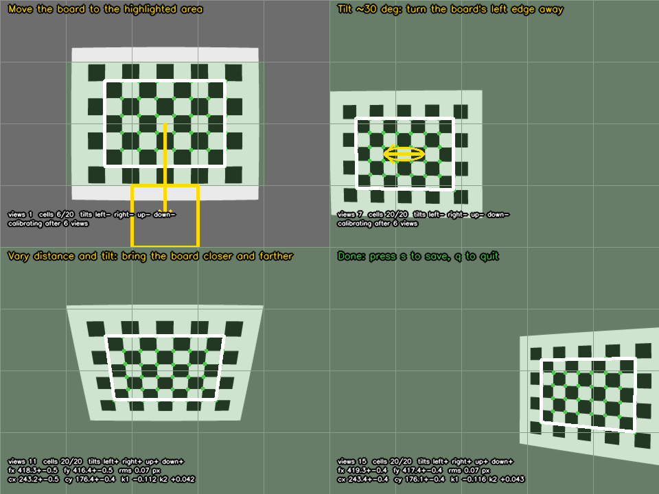

# Calibrate camera intrinsics with live guidance

`calibrex intrinsics guide` calibrates a camera's intrinsics with a checkerboard and tells
you, frame by frame, how to move the board next. It keeps only the frames that add
something, re-estimates the intrinsics after each one, and says when the focal lengths and
the principal point are known well enough. The result is a Kalibr camchain entry, which
Calibrex's camera pairs (`camera-imu`, `camera-lidar`, `camera-focal`) read.



## Run it

You need OpenCV *with* window support: the `opencv` extra installs the headless build, so
install `opencv-python` instead for the live window.

```bash
python -m pip install "calibrex @ git+https://github.com/rsasaki0109/Calibrex.git" opencv-python
calibrex intrinsics guide --board 9x6x0.025 --camera 0 --resolution 1280x720
```

`--board` gives the **inner** corners and the square size in metres (a board of 10 x 7
squares has 9 x 6 inner corners). Prefer a board with one even and one odd number of
squares: a board that looks the same turned half a turn is still usable for intrinsics,
but its corners may come in either order.

Keys: `s` saves the camchain (default `intrinsics_camchain.yaml`, entry `cam0`;
`--output`, `--camera-name`), `q` quits.

A recorded video works too, without a window:

```bash
calibrex intrinsics guide --board 9x6x0.025 --video board.mp4 --no-window \
    --record annotated.avi --output camchain.yaml
```

`--no-window` runs to the end of the video, or until the calibration is done, and saves
what it has. `--record` writes the annotated frames, which is also a way to see the
guidance on a machine whose OpenCV has no window support.

A ROS 2 bag works the same way: `--bag my_bag --topic /camera/image_raw --no-window`.

## Stereo

Give the right camera too, and the guide calibrates both cameras and the right camera's
pose in the left frame (`T_cn_cnm1`, in metres):

```bash
calibrex intrinsics guide --board 9x6x0.025 --camera 0 --right-camera 1
calibrex intrinsics guide --board 9x6x0.025 --camera 0 --side-by-side
calibrex intrinsics guide --board 9x6x0.025 --video left.mp4 --right-video right.mp4 --no-window
calibrex intrinsics guide --board 9x6x0.025 --bag my_bag --topic /left/image_raw \
    --right-topic /right/image_raw --no-window
```

Both images are shown side by side. The guide first takes the left camera through its
cells, tilts and precision (advice starting `Left:`), then the right (`Right:`); the board
usually serves both at once. Then it asks for the board in front of both cameras, at
varied distances and tilts, and keeps each still pose both cameras see. With the
intrinsics fixed, OpenCV's `stereoCalibrate` gives the relative rotation and the baseline
from those views; the status line shows the stereo views and the baseline with its std.
It is done when both cameras are done and at least 10 shared views give the baseline
length to 1 %.

Only still frames are used, so two cameras that are not synchronized (two USB cameras,
`--right-camera`) work: the board does not move between their exposures. Bag topics are
paired by header stamp. The camchain gets `cam0` (left) and `cam1` (right, with
`T_cn_cnm1`).

The baseline's std combines the spread of the estimate over the views (jackknife) with
both cameras' intrinsics moved by their stds: a principal point 1 px off moves the baseline
by about the board distance over the focal length (1.7 mm at 0.7 m with f = 420 px) and
turns the rotation by 1/f rad, and the views cannot show it. On a simulated rig (6 cm
baseline, 480 x 360, the board 0.55-0.9 m away), following the advice took 13 shared views
and gave the baseline length within 1.1 %, each axis within 2.3 mm (under two stds) and the
rotation within 0.25 deg; with the true intrinsics the baseline came within 0.3 mm. For a
better baseline, improve the intrinsics: a larger board, sharper focus, more views.

The right corners are put in the left corners' order assuming the cameras are rolled by
less than 90 deg relative to each other, which every ordinary rig is.

## What the screen shows

- **The advice**, at the top, in this order:
  1. *Show the whole board to the camera*: no board found; every inner corner must be
     in view.
  2. *Hold the board still*: a frame is kept only when the corners moved at most 1 px
     since the previous frame, so motion blur and rolling-shutter skew stay out.
  3. *Move the board to the highlighted area*: the image is cut into 5 x 4 cells
     (`--grid`); a yellow rectangle and an arrow point to the uncovered cell nearest to
     the board. Covered cells are tinted green. The corners and the image edges matter
     most for the distortion and the principal point.
  4. *Tilt ~30 deg: turn the board's left (right, top, bottom) edge away*: the board
     must be seen tilted all four ways (more than 25 deg). A board facing the camera
     leaves the focal length undetermined, so the first calibration waits for six views
     and two tilts.
  5. *Vary distance and tilt*: the cells and tilts are complete but the estimate is not
     yet precise enough; frames whose pose differs from every kept one are added.
  6. *Done*: at least 15 views, the focal lengths' std below 0.3 % of their value, the
     principal point's std below 2 px and a reprojection RMS below 1 px.
- **The board**: its corners in green when still and red when moving; a white outline
  flashes when the frame is kept.
- **The status**, at the bottom: views kept, cells covered, tilts seen (`left+` seen,
  `left-` missing), and the current estimate of `fx fy cx cy k1 k2` with the stds.

## The model and its limits

Two lens models, with Kalibr's names (`--distortion`):

- `radtan` (default): OpenCV's pinhole with radial-tangential distortion `k1 k2 p1 p2`
  (`k3` fixed at 0), for ordinary lenses up to about 90 deg across.
- `equidistant`: OpenCV's fisheye (Kannala-Brandt) model `k1 k2 k3 k4`, for wide-angle and
  fisheye lenses. The camchain says `distortion_model: equidistant`, which Kalibr and
  Calibrex's camera pairs read.

```bash
calibrex intrinsics guide --board 9x6x0.025 --camera 0 --distortion equidistant
```

For the fisheye model the stds come from the calibration's Jacobian, with each view's
pose marginalized out (OpenCV's fisheye calibration does not report them). On a simulated
110 deg fisheye (480 x 360, f = 235 px) following the advice gave the focal lengths within
1 % and the principal point within 2 px. Stereo works the same way: both cameras' corners
are undistorted with their own model before the baseline is fitted, so a fisheye and a
pinhole camera can be paired too. Keep the board within about 80 deg of the optical axis.

The stds are OpenCV's, from the reprojection residuals of the kept views. They assume
independent corner errors, so they understate the error when the corners carry an error
shared within a view (a board that is not flat, a print scaled differently from its
nominal square size, lens effects the model lacks). On a synthetic camera rendered with
~0.1 px of aliasing on the corners, following the advice gave the focal lengths within
0.5 % and the principal point within 1.5 px, a few stds from the truth. Check the square
size of the printed board with a ruler: it scales the poses, not the intrinsics, but a
board that is not flat biases them.
